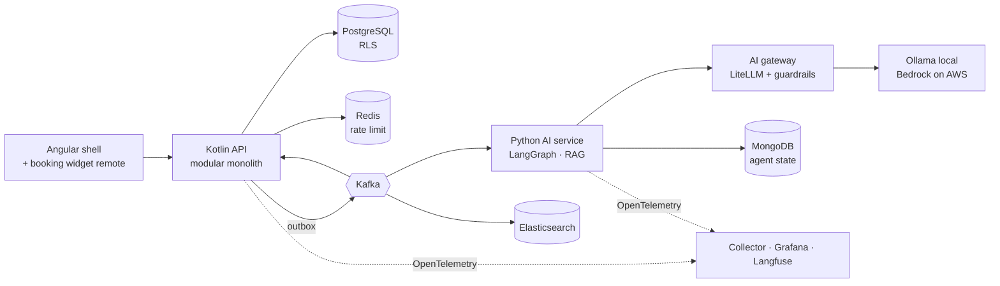

# Estilix

Multi-tenant SaaS for beauty salons and barbershops in Brazil: online booking without a phone call, 3-tap service records, customer history, cash and commission control, "customers to call back" with personalized messages — and an AI assistant that helps the owner act on it.

> Status: **`platform-foundation`, `salon-setup`, `scheduling` and `customers-and-service-records` implemented** — 3-tap service records (comanda) started from the agenda or for walk-ins, customers by phone with visit history, usual return interval and marketing consent, LGPD export and anonymisation, public booking page per salon (calendar, free times in green, code and manage link), staff agenda with blocks, self-service sign-up with support approval, services and professionals, on top of multi-tenancy with Row-Level Security, roles, audit log and personal-data masking. Next: `event-backbone`. Commands marked *(planned)* arrive with the change named next to them.

## Why this project

It is a real product and a portfolio piece. The interesting engineering is not the CRUD, it is the guarantees:

- **Tenant isolation enforced by PostgreSQL Row-Level Security** — a forgotten `WHERE tenant_id` cannot leak another salon's data.
- **LGPD by construction** — personal data is a type (`PersonName`, `Email`, `Phone`) that redacts itself in logs and is masked for platform support; unmasked access needs an audited, time-boxed break-glass session visible to the salon owner.
- **Reliable events** — transactional outbox, Kafka, idempotent consumers, retries and dead-letter queues.
- **AI with guardrails** — RAG, multi-agent assistant, gateway with per-plan quotas, red-team suite in CI.
- **An AWS environment that can be turned off** — idle cost of cents, not dollars.

Every technology maps to a salon problem: see the **[skills map](docs/skills-map.md)**.

## Architecture (target)



## Stack

| Layer | Choice |
|---|---|
| Back-end | Kotlin 2.4 on Java 25, Spring Boot 4.1, Spring Modulith, JdbcClient, Flyway, Resilience4j |
| AI service | Python, FastAPI, LangGraph, PydanticAI, LiteLLM, Ollama, Hugging Face, MLflow, Langfuse |
| Data | PostgreSQL 17 (RLS, exclusion constraints, pgvector), Redis (rate limits), Elasticsearch, MongoDB |
| Messaging | Kafka (outbox), Amazon SQS + SES for notifications |
| Identity | Amazon Cognito (mock-oauth2-server locally) |
| Front-end | Angular, pt-BR, mobile-first, Native Federation |
| Infra | Docker Compose, Kubernetes (k3d / EKS on demand), Terraform, GitHub Actions with OIDC |
| Process | Spec-driven development with [OpenSpec](https://github.com/Fission-AI/OpenSpec) |

## Run locally

Requirements: Docker Desktop and Git Bash (Windows) or any POSIX shell. Java, Node and Python are only needed to develop outside containers.

```bash
./scripts/local.sh up            # core: PostgreSQL, fake login, API, web app (~4 GB RAM)
./scripts/local.sh status        # what is running, URLs and demo users
./scripts/local.sh logs api      # follow one service
./scripts/local.sh down          # stop everything, keep data
./scripts/local.sh down --wipe   # stop and delete local data
./scripts/local.sh up full       # + Kafka, Redis, Elasticsearch, MongoDB, Ollama...   (planned: event-backbone and AI changes)
```

Open http://localhost:4200: the public landing page and the plans page need no login. "Entrar" (or http://localhost:4200/entrar) goes to the fake login page (mock-oauth2-server), which accepts any username — it becomes the token subject. Demo users from the local seed:

| Username | Who | Try |
|---|---|---|
| any new name | A salon owner arriving from the site | Plans → "Assinar" → log in → 3-step wizard → "em análise" |
| `suporte` + claims `{"cognito:groups": ["platform-support"]}` | Platform support | Approval queue (approve or reject with a reason); masked data; break-glass |
| `dona-nova` | Owner of "Studio Lia Nails", in analysis | Waiting screen; after a rejection, "Corrigir e reenviar" |
| `dona-bela` | Owner, Salão Bela Vista | Serviços, Profissionais, Salão (hours with lunch break), Equipe, Acessos |
| `gerente-bela` | Manager | Manages services and professionals; cannot edit the salon profile or the team |
| `pro-bela` | Professional, linked to "Paula" | Reads services and professionals only |
| `dono-ze` | Owner, Barbearia do Zé | Never sees Salão Bela Vista |

Public booking, no login: open http://localhost:4200/agendar/salao-bela-vista → choose a service → (professional or "Qualquer profissional") → a green time → name and phone → confirmed with a 6-digit code and a manage link; "Adicionar mais um serviço" books the next service right when the first ends. Then sign in as `dona-bela` → **Agenda**: the booking is there next to the demo bookings and a block. Two people confirming the same time: the first wins, the second sees "Esse horário acabou de ser preenchido".

Service records, as `dona-bela` → **Agenda**, today:
- Tap Marina's booking, then "Iniciar atendimento". The comanda opens with the price filled in. "Concluir" → "Pix" closes it, and the booking turns "Concluído".
- Carla's 09:00 shows "Não veio", and that time is free again.
- Fernanda is "Em atendimento" with an open comanda.
- "Novo atendimento" takes a walk-in: type the phone and a known customer's name appears.

Then open **Clientes** → Marina: 3 visits, "costuma voltar a cada 31 dias", consent history. Under "Privacidade (LGPD)" are the export and anonymisation. As `pro-bela`, Clientes shows only Paula's customers.

The full sign-up flow, end to end: open `/planos` → "Assinar" → log in as a new name → choose "Barbearia" → name, phone and city (hours and services already filled) → accept the terms → "Enviar para análise". Then log in as `suporte`, open "Salões aguardando liberação" and approve. Log in again with the new name: the salon opens with its services.

Swagger UI (local profile): http://localhost:8080/swagger-ui.html

## Tests

```bash
cd backend && ./gradlew check        # 300 tests: real PostgreSQL and Redis (Testcontainers) + real signed JWTs
cd frontend && npx ng lint && npx ng test --watch=false && npx ng build
```

What the back-end suite proves, among others:

- a query **without** `WHERE tenant_id` still returns only the current salon; cross-salon updates, deletes and inserts fail in the database, also on a single reused connection;
- every table with `tenant_id` has RLS, FORCE and a policy (`RlsGuardTest`, with a probe proving the guard catches an unprotected table);
- the application connects as a role that cannot bypass RLS and owns no table;
- known names, e-mails and phones submitted to the API never appear in logs or error bodies (`LogHygieneTest`);
- the audit log cannot be updated or deleted, and a rolled-back action leaves no event;
- break-glass: reason ≥ 20 chars, ≤ 60 min, one salon, one support user, database clock, audited reads;
- readiness turns 503 when the database is paused while liveness stays UP, then recovers;
- Spring Modulith module boundaries (a probe adding `tenancy → identity` makes the build fail);
- the tenant lifecycle: the application cannot create an active salon or approve its own, one open application per person even under concurrency, concurrent approve/reject applies exactly one decision;
- overlapping opening hours are refused by an exclusion constraint, and a professional can never be linked to another salon's service (composite foreign key), even with the right RLS context;
- the public endpoints expose no salon data; the landing page and plans are prerendered HTML;
- 20 concurrent bookings for the same professional and time: exactly one wins (with a negative control that drops the exclusion constraint and shows duplicates); a block can never overlap a booking;
- public rate limits per IP and per phone return 429 with Retry-After, keep working per instance when Redis is down, and readiness stays UP without Redis;
- 10 concurrent "Iniciar atendimento" on one booking open exactly one comanda, repeated 20 times. A negative control removes the status guard and shows the duplicates;
- a walk-in over a booking is refused naming the booking time, and leaves no record and no customer behind;
- no-show frees the time, while in-service and done keep it (exclusion constraint predicate);
- anonymisation keeps the salon's totals, erases name, phone and notes, kills the old manage link and frees the phone for a new customer;
- a professional sees only the customers and records of their own professional (not-found otherwise);
- customer names, phones and notes never reach logs, error bodies or audit details.

The Kotlin compiler targets JVM 25 (`jvmTarget = 25`, class file major version 69).

## Decisions

- [ADR 0001 — Tenant isolation with PostgreSQL Row-Level Security](docs/adr/0001-row-level-security.md)
- [ADR 0002 — Identity in the token, salon roles in the database](docs/adr/0002-roles-in-database-not-token.md)
- [ADR 0003 — Personal data declared as types](docs/adr/0003-personal-data-as-types.md)
- [ADR 0004 — Tenant lifecycle guarded by the database; self-service onboarding with approval](docs/adr/0004-tenant-lifecycle-and-onboarding.md)
- [ADR 0005 — One agenda table guarded by an exclusion constraint; public requests under RLS](docs/adr/0005-agenda-entries-and-public-tenant-context.md)
- [ADR 0006 — Service records drive the booking lifecycle; customers are anonymised, never deleted](docs/adr/0006-service-records-lifecycle-and-anonymisation.md)

## Turn AWS on and off

The environment is split in layers so that turning it off leaves only cents per month:

| Layer | Contents | When on | When off |
|---|---|---|---|
| foundation | Terraform state, ECR, Cognito, S3 + CloudFront, budget alarm | always | ~US$ 1–3 / month |
| data | RDS PostgreSQL | while up | snapshot only |
| runtime | ECS Fargate services, API Gateway, SQS, SES | while up | nothing |
| demo extras | EKS, Kafka broker, Elasticsearch, Bedrock usage | only with `--demo` | nothing |

```bash
./scripts/aws.sh up              # restore DB from last snapshot, start runtime, wait for readiness, print URL (~10–15 min)
./scripts/aws.sh up --demo       # same + demo extras (EKS etc.) — remember: hourly cost
./scripts/aws.sh status          # what is on, estimated cost per day, leftovers that still bill
./scripts/aws.sh down            # final snapshot, destroy runtime and data layers, check leftovers
```

*(planned: `aws-deployment` and `kubernetes-deployment`)* A scheduled GitHub Actions workflow can run `down` every night as a safety net, and an AWS Budget alarm e-mails when spend passes a threshold.

## Roadmap

Each item is one OpenSpec change under `openspec/changes/`.

**Track A — sellable MVP:** `platform-foundation` · `salon-setup` · `scheduling` · `customers-and-service-records` · `event-backbone` · `finance` · `notifications` · `customer-retention` · `aws-deployment`

**Track B — AI and platform showcase:** `ai-gateway-and-guardrails` · `help-center-rag` · `salon-assistant-agents` · `natural-language-booking` · `booking-widget-microfrontend` · `customer-search` · `kubernetes-deployment`

**Later:** inventory and restock reminders, dashboard + Excel export, subscription billing, supplier invoice import with AI.

## Working with the specs

```bash
openspec list                                   # changes in progress
openspec show platform-foundation               # read a change
openspec validate platform-foundation --strict  # check the artifacts
```
