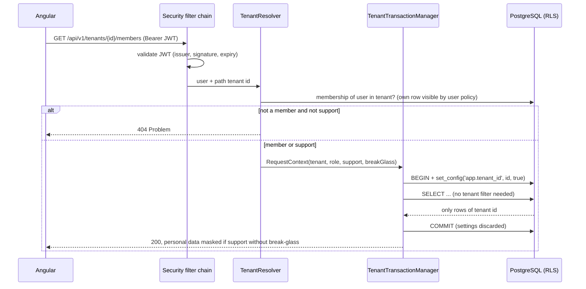
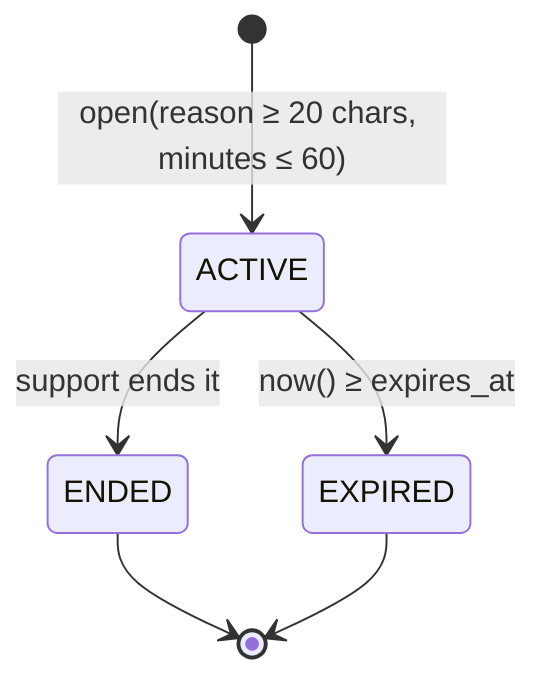
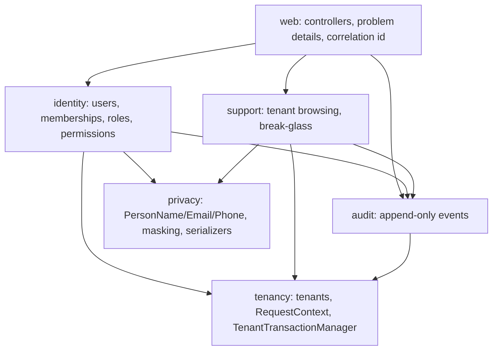

# Design

## Context

Greenfield repository (see proposal.md - Why). Every later change (agenda, service records, finance) will add tenant-owned tables and endpoints, so the mechanisms decided here are the template they copy. Behavior is specified in `specs/tenancy/tenant-isolation`, `specs/identity/access-control`, `specs/identity/support-access`, `specs/platform/audit-log` and `specs/platform/personal-data-protection`.

Constraints that shape the design: one shared PostgreSQL database, Kotlin on Java 25 with Spring Boot 4, Amazon Cognito as identity provider in AWS, everything runnable with `docker compose up`, and LGPD processor duties for the platform operator.

## Goals / Non-Goals

**Goals:**
- A forgotten tenant filter, a wrong id in a URL or a bug in a repository must not leak data across tenants — enforced by PostgreSQL.
- Adding a new tenant-owned table or a personal-data field must be a small, copyable recipe, checked by tests.
- The same code runs locally (fake identity provider) and on AWS (Cognito) by configuration only.

**Non-Goals:**
- Protection against a fully compromised application process (it can set any tenant context). RLS protects against bugs, not against an attacker running code inside the API.
- Fine-grained per-feature permissions of PROFESSIONAL (own agenda only) — each feature change adds its permissions to the catalog defined here.
- Terraform for Cognito/RDS (in `aws-deployment`).

## Decisions

### D1. Isolation: shared tables + PostgreSQL Row-Level Security

Every tenant-owned table has `tenant_id uuid not null` and:

```sql
alter table x enable row level security;
alter table x force row level security;
create policy tenant_isolation on x
  using (tenant_id = current_setting('app.tenant_id', true)::uuid)
  with check (tenant_id = current_setting('app.tenant_id', true)::uuid);
```

When `app.tenant_id` is not set, `current_setting(..., true)` returns NULL, the comparison is NULL and no row matches: the system **fails closed**.

Alternatives considered:
- *Filter only in application code (WHERE / Hibernate filter)*: one forgotten condition leaks data; nothing stops it. Rejected — it is exactly the bug class we want to remove.
- *Schema per tenant*: strong isolation, but N migrations per deploy, connection/search_path juggling and painful cross-tenant support queries. Overkill for hundreds of small salons.
- *Database per tenant*: highest isolation and cost; kills the "turn AWS off for cents" goal.

### D2. Tenant context set per transaction by the transaction manager

A request-scoped `RequestContext` holds user id, tenant id, support flag and break-glass session. A subclass of `DataSourceTransactionManager` overrides `prepareTransactionalConnection` (the hook Spring already calls right after `BEGIN`) and runs:

```sql
select set_config('app.tenant_id', ?, true),   -- true = local to this transaction
       set_config('app.user_id',   ?, true);
```

Because the settings are transaction-local, they vanish at COMMIT/ROLLBACK, so a pooled connection can never carry tenant A into a request for tenant B. Code that touches the database outside a transaction has no tenant and sees nothing (fail closed). Support requests additionally run as `SET TRANSACTION READ ONLY`, so "support cannot write" is enforced by the database too.



Alternatives considered:
- *`SET` (session level) in a servlet filter*: leaks to the next borrower of the connection if a reset is missed. Rejected.
- *A separate connection pool per tenant*: does not scale and still needs RLS for safety.
- *AOP around every repository*: easy to bypass by a new repository; the transaction manager is a single choke point.

### D3. Platform tables with relationship-based policies

`tenant`, `app_user` and `membership` are needed before a tenant is chosen (`/me` lists a user's salons). They also use RLS, with policies based on the current user:
- `membership`: visible when `tenant_id = app.tenant_id` **or** `user_id = app.user_id`.
- `tenant`: visible when it is the current tenant, when the current user has a membership in it, or when `app.support = 'on'`.
- `app_user`: own row, or users who share the current tenant.

Writes to `membership` still require `tenant_id = app.tenant_id`.

### D4. Two database roles

- `estilix_owner`: owns the schema, runs Flyway migrations only; `BYPASSRLS` because data migrations and the local seed work across salons (with `FORCE ROW LEVEL SECURITY` even the table owner is otherwise filtered). Never used by the running application.
- `estilix_app`: runtime role; `SELECT/INSERT/UPDATE/DELETE` on business tables, `SELECT/INSERT` only on `audit_event`; **not** owner, **no** `BYPASSRLS`.

A trigger on `audit_event` also raises on UPDATE/DELETE, so even the owner cannot rewrite history without first dropping the trigger in a migration (visible in review).

Alternative: a single role with `FORCE ROW LEVEL SECURITY` only. Rejected — owners can still disable RLS with `ALTER TABLE`, and the app would hold DDL rights it never needs.

### D5. Data access with Spring `JdbcClient` and explicit SQL

Same choice as BarberBook: explicit SQL makes RLS behavior and every query visible in review, and there is no persistence context caching rows across tenants.

Alternatives: *JPA/Hibernate* (hidden queries, first-level cache, lazy loading outside the transaction where no tenant is set → confusing empty results); *jOOQ* (great type safety, but code generation and licensing for some features add setup cost not justified yet); *Exposed* (Kotlin-idiomatic but small ecosystem with Spring transactions).

### D6. Authentication: OAuth2 resource server; identity only in the token

Spring Security `oauth2-resource-server` validates the JWT (issuer, signature via JWKS, expiry, audience/client id). The token proves **who** the user is; **tenant roles live in the database** (`membership`). Reasons: a role change takes effect on the next request (no waiting for token expiry), and a user can have different roles in different salons, which does not fit flat token claims.

`PLATFORM_SUPPORT` is the exception: it comes from the Cognito group `platform-support` (`cognito:groups` claim), managed only in the Cognito console/Terraform — no tenant user can grant it.

Local development and tests use **mock-oauth2-server** (container) as issuer: real OIDC login flow for Angular, real JWT signatures for the API. Only the issuer URL changes between environments.

Alternatives: *Keycloak locally* (heavier, and its tokens differ from Cognito more than a configurable mock); *Spring Authorization Server embedded* (would put an identity provider inside the product); *roles as Cognito groups per tenant* (group explosion: one group per salon and role).

### D7. Tenant in the URL path

`/api/v1/tenants/{tenantId}/...` instead of a header or a "current tenant" stored on the server. Explicit, stateless, bookmarkable, easy to test. A non-member gets **404**, not 403, so tenant ids cannot be probed.

### D8. Personal data as types (`PersonName`, `Email`, `Phone`, `PersonalText`)

Personal data is declared by its **type**, not by an annotation that can be forgotten on a `String`:
- `@JvmInline value class Email(val value: String)` etc., each with `toString()` returning a redacted form, so string templates, `data class` `toString()` and logs never print the value.
- One Jackson serializer per type reads `RequestContext`: unmasked for tenant members, masked for support without an active break-glass session, and records an unmasked-read counter when break-glass is active.
- Masking rules (spec: Masking format) are pure functions with unit tests.

Alternatives: *`@PersonalData` annotation on String fields* (easy to forget, `toString()` still leaks); *masking in SQL views for support* (duplicates every query and mixes presentation into the database).

### D9. Log hygiene by construction plus a test

- No request/response body logging anywhere; access logs record method, path template, status, duration, correlation id, user id.
- The RFC 9457 handler never includes `rejectedValue`; validation problems list field + rule only.
- Structured JSON logs (Spring Boot ECS format) with MDC: correlation id, tenant id, user id.
- A reusable test helper captures all log output during an API test and asserts that none of the submitted personal values appear. Every later change reuses it.

### D10. Break-glass session lifecycle



`break_glass_session` is tenant-owned (RLS, visible to owners). Expiration is evaluated with the database clock (`expires_at > now()`) on every request, so no scheduler is needed for correctness; a nightly job only marks rows EXPIRED and writes the audit event. At most one active session per (support user, tenant), enforced by a partial unique index. Each request that serializes unmasked personal data during a session writes **one** audit event with resource type and ids and increments `unmasked_reads`.

### D11. Audit in the same transaction

Audit events are inserted in the same transaction as the action, so a rolled-back action leaves no "success" event. An outbox/event stream is unnecessary at this scale; Spring Modulith events may publish them later for notifications.

### D12. Modules (Spring Modulith)



`privacy` and `tenancy` are shared kernels; a Modulith verification test keeps the dependency graph acyclic.

### D13. Front-end shell

Angular (latest stable), standalone components, signals, zoneless, mobile-first layout with a bottom navigation on phones. Sign-in uses Authorization Code + PKCE against the issuer's hosted login (Cognito managed login in AWS, mock-oauth2-server locally) through `angular-auth-oidc-client`. Tokens are kept in `sessionStorage` (scoped to the tab, gone when it closes) with refresh-token rotation. Pure in-memory storage was the first choice, but the redirect-based code flow must keep `state` and the PKCE `code_verifier` across the round trip to the login page, which memory cannot do; the XSS exposure of `sessionStorage` is mitigated by a strict Content Security Policy (no inline scripts, API and issuer as the only `connect-src`). Only the last chosen tenant id is kept in `localStorage` (not personal data). An HTTP interceptor adds the token and the tenant prefix; the menu is driven by the permissions returned by `/api/v1/me`.

Alternative: a custom login form calling Cognito APIs directly — more UX control, but we would handle passwords, MFA and lockout ourselves. Rejected for the foundation; can be revisited for branding.

## Risks / Trade-offs

- [A query outside a transaction silently returns nothing] → fail-closed is intended; `spring.datasource` auto-commit queries are blocked by an integration test that runs every repository method outside a transaction and expects empty/denied results, and repositories are only called from `@Transactional` services.
- [RLS policies forgotten on a new table] → a migration test queries `pg_class`/`pg_policies` and fails if any table with a `tenant_id` column lacks RLS + FORCE + a policy.
- [Policy cost on large tables] → `tenant_id` is the first column of every index on tenant-owned tables; revisit with `EXPLAIN` in the dashboard change.
- [Support flag `app.support` can be set by the app itself] → accepted (see Non-Goals); support requests are also READ ONLY at transaction level and every unmasked read is audited.
- [Kotlin compiler support for JVM target 25] → task 1.1 verifies `jvmTarget = 25`; fallback is toolchain 25 with the highest supported `jvmTarget`, recorded in the README.
- [Jackson 3 + Kotlin value classes] → serializers are registered per type and covered by tests in task group 5; if value classes misbehave, fall back to small final classes with the same API.
- [Cognito managed login language] → if pt-BR is not available for all screens, the login page shows the Estilix brand and the custom-UI alternative from D13 is scheduled in `salon-setup`.

## Migration Plan

Greenfield: no data migration. Flyway creates roles' grants, platform tables and RLS policies (`V1__platform.sql`, `V2__audit.sql`, `V3__break_glass.sql`). Rollback = drop the database (local only in this change).
