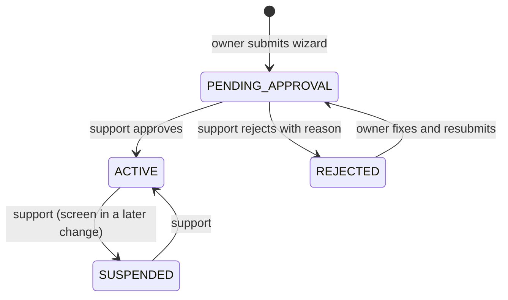
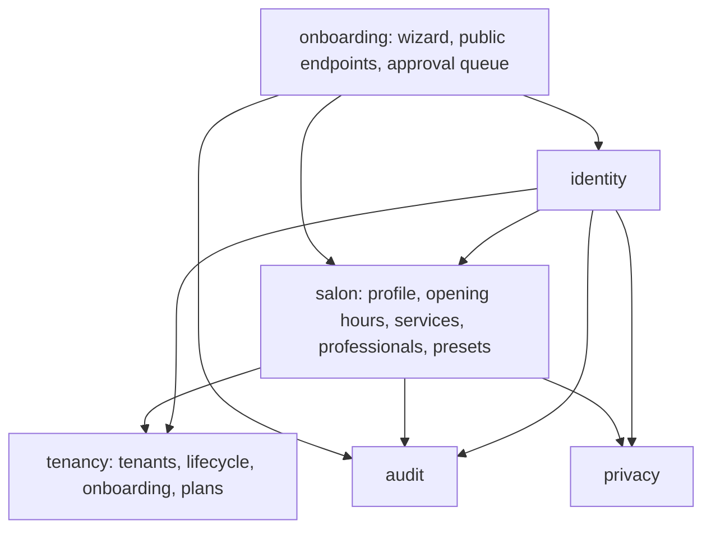
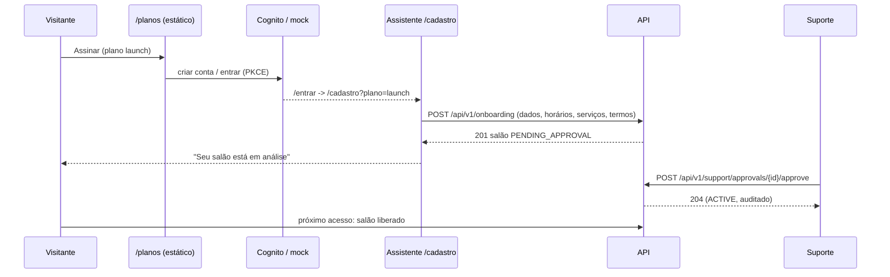

# Design

## Context

Builds on `platform-foundation` (see its design): RLS per transaction through `TenantTransactionManager`, roles in `membership`, `PermissionCatalog`, personal data as types, audit in the same transaction, `TenantAccessInterceptor` resolving `/api/v1/tenants/{tenantId}/**`. Today a tenant can only be created by SQL (seed or fixtures); `tenant` has a SELECT policy only; statuses are ACTIVE/SUSPENDED; the Angular app sends every route through the sign-in guard and the OIDC callback lands on `/`.

Requirements: `specs/marketing/public-site`, `specs/tenancy/tenant-onboarding`, `specs/salon/*`, and the modified "Tenant lifecycle status" in `specs/tenancy/tenant-isolation`.

## Goals / Non-Goals

**Goals:**
- A salon can go from landing page to "em análise" without anyone from the platform involved, and from "em análise" to live with two taps from support.
- The data the agenda will need (hours, services, professionals, durations) exists with rules the database enforces.
- Public pages are fast, indexable and cheap: static HTML.

**Non-Goals:**
- Payment, trials with expiry, plan limits enforcement.
- Holidays, exceptional closures and professionals' days off (come with `scheduling`, where they affect availability).
- Commission settings per professional (come with `finance`).

## Decisions

### D1. Tenant lifecycle as a state machine in the database

Transitions are conditional UPDATEs (`... where id = :id and status = 'PENDING_APPROVAL'`); zero rows means the salon was not in the expected state → `conflict`. Two support users deciding at once: only one UPDATE matches (same technique as BarberBook's confirm/cancel). `TenantAccessInterceptor` maps PENDING_APPROVAL/REJECTED to the new problem types `tenant-pending-approval` / `tenant-rejected` for members.

Alternative: a separate `tenant_application` table holding submissions until approval, copying into `tenant` on approval. Rejected: duplicate schema for every salon field and a copy step that can fail; the status column plus RLS already keeps pending salons invisible to their features.

### D2. Creating a tenant under RLS without new privileges

The onboarding service generates the tenant id first, then runs the whole submission in one transaction **with that id as the current tenant**, so `app_tenant_id()` already equals the new id. New policies:
- `tenant_insert`: `with check (id = app_tenant_id() and status = 'PENDING_APPROVAL')` — the application can only create pending tenants, never active ones.
- `tenant_owner_update`: owners update profile columns of their tenant (`id = app_tenant_id()`); status changes go through `tenant_status_update` allowed only when `app_is_support()` or for the REJECTED→PENDING resubmission by the owner. Column-level grants keep `status`, `approved_at`, `rejection_reason` writable only through those statements.

The membership insert reuses the existing `membership_insert` policy (tenant matches). Opening hours and services inserts use their own tenant policies. One transaction → all or nothing (spec "Invalid data saves nothing").

"One salon awaiting approval per user": checked in the transaction and backed by a partial unique index on `tenant (created_by) where status in ('PENDING_APPROVAL','REJECTED')`, so two concurrent submissions cannot both pass.

Alternative: a SECURITY DEFINER function `create_tenant(...)`. Rejected: business validation would move into PL/pgSQL and away from tested Kotlin code.

### D3. Support queue reads contact data unmasked by purpose

The approval queue endpoint returns a dedicated view model whose owner name/e-mail and salon phone use a `PurposeBoundContact` response type that the serializer leaves unmasked for support **only** when the salon is PENDING_APPROVAL or REJECTED (checked in the query: the queue selects only those statuses). Everywhere else the same fields keep the default `PersonName`/`Email`/`Phone` masking. Opening the queue is audited once per request (`APPROVAL_QUEUE_VIEWED`) to keep the purpose traceable.

Alternative: require break-glass to approve. Rejected: approval is a routine, pre-contractual task, not an emergency; break-glass would train support to open emergency access daily and devalue it.

### D4. New module `salon`

Implementation note (decided while building): onboarding became its own module, `onboarding`, instead of living in `tenancy`. It orchestrates `identity` (owner membership), `salon` (hours, services) and `audit` in one transaction and also owns the public endpoints and the support approval queue. Depending "downwards" on those modules is simpler and keeps the graph acyclic without a `SalonInitializer` interface. Linking a professional to a member still goes through the `MembershipLookup` interface in `tenancy`, implemented by `identity`, so `salon` never depends on `identity`; `identity` reads `salon` only to show a member's linked professional in `/me`.

Resubmission edits the profile and hours only; services are edited after approval in the "Serviços" screen.

The OIDC library navigates to its `postLoginRoute` (default `/`) after the callback; it is set to `/entrar` so a sign-in never lands on the public page.

### D5. Data model

| Table | Key columns | Notes |
|---|---|---|
| `plan` | `code`, `name`, `price_cents`, `features jsonb`, `active` | Platform table (no tenant), read by a public endpoint; seed: `launch`, R$ 0 |
| `tenant` (+cols) | `slug unique`, `phone`, `address_*`, `plan_code`, `terms_version`, `terms_accepted_by/at`, `created_by`, `submitted_at`, `decided_by/at`, `rejection_reason` | Status check adds PENDING_APPROVAL, REJECTED |
| `opening_hours` | `tenant_id`, `weekday 1..7`, `starts`, `ends` | Exclusion constraint per (tenant, weekday) on `int4range` of minutes → no overlap in the database |
| `service` | `id`, `tenant_id`, `name`, `name_key`, `category`, `duration_minutes`, `price_cents`, `price_type`, `active`, `position` | `unique (tenant_id, name_key)`; checks for duration `% 15 = 0` and `15..480`, price `>= 0` |
| `professional` | `id`, `tenant_id`, `display_name`, `user_id null`, `color`, `active`, `own_hours bool` | `unique (tenant_id, user_id)`; FK `(tenant_id, user_id)` → `membership` |
| `professional_service` | `tenant_id`, `professional_id`, `service_id` | Composite FKs including `tenant_id` so a link can never cross salons |
| `professional_hours` | like `opening_hours` + `professional_id` | Same exclusion constraint |

Every table with `tenant_id` gets RLS + FORCE + policy; the foundation's `RlsGuardTest` checks it automatically.

Money: `price_cents bigint` in the database, `BigDecimal` scale 2 in the API (`"45.00"` as a string in JSON to avoid float), rejecting more than two decimals. `name_key` = lowercase without accents (`unaccent`), filled by the application, so "Corte Masculino" and "corte masculino" collide.

Composite foreign keys `(tenant_id, service_id)` → `service (tenant_id, id)` are the database-level guarantee for "Service of another salon" — RLS hides foreign rows from reads, the composite FK makes a cross-salon link impossible to store even if application code is wrong.

Alternatives: `numeric(10,2)` for money (fine too; cents chosen for exact arithmetic in Kotlin `Long` and simpler sums in `finance`); hours as JSON per tenant (rejected: no database-level overlap check, harder availability queries in `scheduling`).

### D6. Effective hours are computed, not copied

A professional with `own_hours = false` has no rows: effective hours = salon hours, so changes to the salon propagate. With own hours, effective = own ∩ salon (clipped). The API returns effective hours plus a `conflicts` list when own intervals fall outside the salon's, which the screen shows. `scheduling` will read the same function.

Alternative: copy salon hours into each professional on creation. Rejected: stale copies when the salon changes its hours — the most common support ticket in booking tools.

### D7. Presets as code, not data

Presets per establishment type are a Kotlin catalog (name, category, duration, suggested price, price type), versioned with the code and covered by tests. Suggested prices are conservative round numbers and always editable in the wizard.

### D8. Public pages prerendered; app stays client-side

Angular hybrid rendering: `/` and `/planos` are prerendered at build time (SSG) — full HTML for search engines and fast first paint — while every app route is client-rendered (`RenderMode.Client`) behind the sign-in guard. The OIDC `redirectUrl` moves to `/entrar`, a route that completes the callback and then applies `landingFor`; the landing page itself never forces sign-in. Plans in the prerendered HTML come from the catalog at build time and are refreshed client-side from `GET /api/v1/public/plans`.

Alternative: a separate static marketing site (Astro, etc.). Rejected for now: a second toolchain and design system for two pages; Angular's prerender is enough and shares components and tokens. Revisit if the marketing site grows (blog, SEO landing pages per city).

### D9. Permissions added to the catalog

| Permission | OWNER | MANAGER | PROFESSIONAL | Support |
|---|---|---|---|---|
| VIEW_SALON | ✓ | ✓ | ✓ | ✓ (masked) |
| MANAGE_SALON | ✓ | | | |
| VIEW_SERVICES | ✓ | ✓ | ✓ | ✓ |
| MANAGE_SERVICES | ✓ | ✓ | | |
| VIEW_PROFESSIONALS | ✓ | ✓ | ✓ | ✓ (masked) |
| MANAGE_PROFESSIONALS | ✓ | ✓ | | |

The web menu gains "Salão", "Serviços" and "Profissionais", shown by these permissions.

## Risks / Trade-offs

- [Spam sign-ups fill the support queue] → one pending salon per user (index), sign-up requires a verified account in Cognito; rate limiting with Redis arrives in `scheduling`.
- [Support sees owner contact unmasked] → limited to pending/rejected salons, purpose stated in the terms, every queue view audited; masked again once the salon is ACTIVE.
- [Prerendered plans out of date] → the page refreshes the catalog client-side; prices are R$ 0 during launch anyway.
- [Archive order] → the MODIFIED requirement needs `tenancy/tenant-isolation` in the main specs: `platform-foundation` must be archived before this change is archived (tasks group 0).
- [Composite FKs make deletes heavier] → services and professionals are deactivated, never deleted.
- [Effective hours computed on read] → trivial cost (≤ 7 days × few intervals); cached by the agenda later if needed.

## Migration Plan

Flyway `V4__onboarding_and_plans.sql` (tenant columns, status check, policies, `plan` + seed `launch`), `V5__salon_catalog.sql` (hours, services, professionals, links). Existing tenants (seed) keep ACTIVE and get slugs generated from their names in the migration. The local demo seed gains services, hours and professionals for both demo salons, plus one pending salon to show the support queue. Rollback: local only (drop database).

## Open Questions

- Exact wording and version of the terms of use: a placeholder text (`terms v0-draft`) is used now; the final text can be swapped without code changes.
