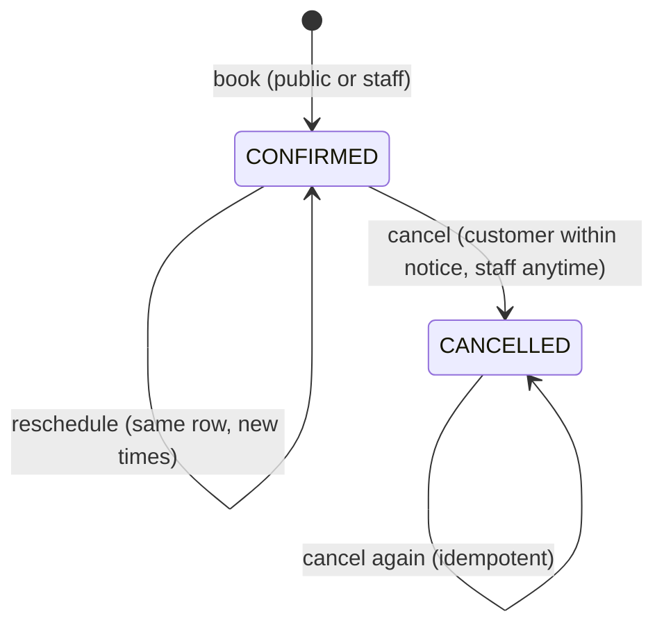
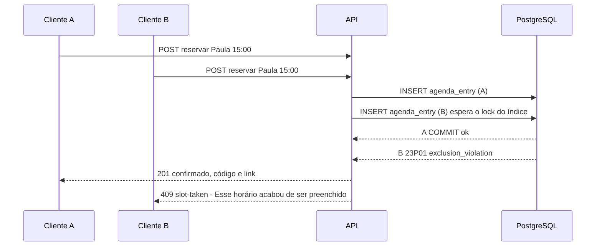
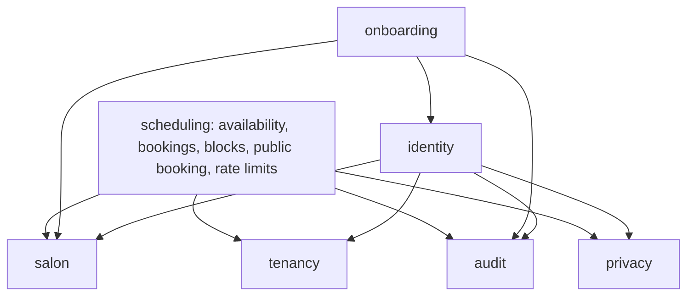

# Design

## Context

Builds on the archived specs (`tenancy/*`, `identity/*`, `platform/*`, `salon/*`, `marketing/*`). Relevant code today: `TenantTransactionManager` sets the tenant per transaction; `salon` has `ProfessionalRepository`, `ServiceRepository`, `SalonRepository.hours()` and `EffectiveHours.of(...)` (own ∩ salon hours, the function this change reuses); `PersonalData` types mask for support; `onboarding.PublicController` already serves unauthenticated `/api/v1/public/**`; `btree_gist` exists (init script); BarberBook proved the exclusion-constraint + race-test approach.

Requirements: `specs/scheduling/availability`, `specs/scheduling/bookings`, `specs/scheduling/public-booking`, `specs/scheduling/staff-agenda`, and the modified display-name rule in `specs/salon/professionals`.

## Goals / Non-Goals

**Goals:**
- Double booking impossible at the database level, also between a booking and a block.
- A public request (no login) still runs under Row-Level Security of exactly one salon.
- The public page stays usable when Redis is down.

**Non-Goals:**
- Reminders and confirmations by e-mail/WhatsApp (`notifications`).
- Attendance, no-show, payment (`customers-and-service-records`, `finance`).
- Recurring blocks and holiday calendars.

## Decisions

### D1. One `agenda_entry` table for bookings and blocks

Bookings and blocks both occupy a professional's time, so they live in one table with `kind` BOOKING | BLOCK and one exclusion constraint:

```sql
exclude using gist (
  professional_id with =,
  tstzrange(starts_at, ends_at, '[)') with &&
) where (status = 'CONFIRMED')
```

Blocks are always `CONFIRMED` while they exist (removed = deleted). Check constraints enforce per-kind columns (a BOOKING has service, customer name and phone; a BLOCK has none). Half-open ranges `[)` make 15:00–15:30 and 15:30–16:00 compatible. Composite foreign keys `(tenant_id, professional_id)` and `(tenant_id, service_id)` keep references inside the salon.

Alternatives:
- *Two tables (`booking`, `time_block`)* — an exclusion constraint cannot span tables; overlap between them would need a trigger with locks. Rejected.
- *Check availability in Kotlin, then insert* — a classic check-then-act race; two requests both see "free". Rejected (BarberBook's lesson).
- *`SELECT ... FOR UPDATE` on a professional row* — serializes every booking of a professional, works, but the constraint is simpler, faster and impossible to forget.



### D2. First commit wins, made visible to the customer



`23P01` is translated into the problem type `slot-taken` (409). The page shows the message and reloads the day's times. Reschedule is an `UPDATE` of the same row, so it hits the same constraint; on violation the transaction rolls back and the booking stays where it was.

### D3. "Qualquer profissional" with savepoints

Candidates = active professionals who perform the service and are free at that time (by the availability function), ordered by number of bookings that day (fairness), then by name. Each insert attempt runs in a nested transaction (savepoint, `PROPAGATION_NESTED`, supported by `DataSourceTransactionManager`): on `23P01` the savepoint is rolled back and the next candidate is tried. All candidates taken → `slot-taken`.

### D4. Public requests under RLS without a login

`GET /api/v1/public/salons/{slug}` and the booking endpoints resolve the tenant through a `SECURITY DEFINER` function `active_tenant_id(slug)` (returns the id only for ACTIVE salons), then run in `RequestContext(tenantId = id, publicRequest = true)` — the same `TenantTransactionManager` path as staff requests, so every query is filtered by RLS. The public context has no user and no role; public services check explicitly what a customer may do (book, manage their own group).

Alternative: a separate database role for public traffic. Rejected for now: RLS already confines the request to one salon; a second pool doubles connections for little gain.

### D5. Availability computed in Kotlin from effective hours

For a day in the salon's time zone: effective hours of each professional (`EffectiveHours.of`), minus busy ranges (confirmed entries of that day, one query), minus times before `now + notice`; candidate starts on the 15-minute grid where `[start, start + duration)` fits. The month view runs the same function per day of the window with one query for all entries of the range. Pure function, unit-tested with a fixed `Clock`. Brazil has no DST since 2019, but all conversions go through `ZoneId` so a future change is handled.

Free times are a hint; the constraint (D1) is the guarantee.

### D6. Booking group, code and manage link

`booking_group(id, tenant_id, phone, code_hash, token_hash, created_at)`; each booking points to its group; chained services join the same group.
- Code: 6 random digits (`SecureRandom`); stored as `HMAC-SHA256(pepper, tenant_id | phone | code)` — a plain hash of 6 digits would be brute-forced offline in milliseconds; the pepper lives in configuration (Secrets Manager on AWS).
- Token: 32 random bytes, base64url in the link; stored as `SHA-256(token)` (high entropy, no pepper needed).
- Phone normalized to E.164 (`+55` + DDD + number) before hashing and storing; the customer can type it with or without formatting.

### D7. Rate limiting with Redis counters and a local fallback

Implementation note (decided while building): fixed-window counters in Redis (`INCR` + `EXPIRE` per key `rl:{limit}:{subject}:{window}`) replaced Bucket4j token buckets. They are a few lines, easy to explain and to test (the key is visible in Redis); the only cost is that a burst can straddle two windows (up to 2× the limit for a moment), which is acceptable for abuse protection. The circuit breaker is a small time-based switch (30 s) instead of a library.

Original plan below, kept for the record.

Token buckets (Bucket4j) stored in Redis (Lettuce) so all API instances share limits:

| Key | Limit |
|---|---|
| IP, public reads | 120 / minute |
| IP, booking writes | 10 / minute |
| phone, booking writes | 5 / hour |
| phone, code attempts (failures only) | 5 / 15 minutes |

If Redis fails (timeout 200 ms), a circuit breaker opens and an in-process Caffeine bucket map applies the same limits per instance (spec "Limiter store down"); the health indicator shows Redis DOWN but readiness stays UP (Redis is not required to serve). Client IP comes from `X-Real-IP` set by our nginx/API Gateway only (`server.forward-headers-strategy=native` with trusted proxies), never from a client-supplied header.

"At most 3 active future bookings per phone per salon per day" is checked inside the booking transaction after `pg_advisory_xact_lock(hashtext(tenant_id || phone))`, so two concurrent requests of the same phone cannot both pass the count.

Alternatives: nginx `limit_req` (per IP only, no phone dimension; kept as an extra outer layer later), API Gateway throttling on AWS (coarse, per route; complements, not replaces), in-memory only (limits multiply with instances).

### D8. Data model

| Table / column | Notes |
|---|---|
| `tenant.booking_days_ahead`, `booking_min_notice_minutes`, `booking_cancel_notice_minutes` | Defaults 30 / 60 / 120, checks for ranges |
| `booking_group` | tenant-owned, RLS; `phone`, `code_hash`, `token_hash unique` |
| `agenda_entry` | tenant-owned, RLS; `kind`, `professional_id`, `service_id`, `group_id`, `starts_at`, `ends_at`, `status`, `customer_name`, `customer_phone`, `origin`, `block_reason`, `cancelled_by`, `cancelled_at`, `created_at`; exclusion constraint D1; index `(tenant_id, starts_at)` |

Customer name/phone are `PersonName`/`Phone` in the API (masked for support, redacted in logs). Retention of bookings and their personal data is defined with the customers module.

### D9. Module `scheduling` and permissions



New permissions: `VIEW_AGENDA` (OWNER, MANAGER, PROFESSIONAL, support), `MANAGE_AGENDA` (OWNER, MANAGER, PROFESSIONAL), `MANAGE_BOOKING_RULES` (OWNER). A PROFESSIONAL is further restricted in the service layer to the professional linked to them (`ProfessionalRepository.findByUser`); a request for another professional → 403.

### D10. Front-end

- Public pages `/agendar/:slug` and `/agendamento/:token`: client-rendered (per-salon data, no login), outside the sign-in guard, phone-first. A month calendar component enables only bookable days; the day's times show as green buttons (free) and faded disabled buttons (unavailable). On `slot-taken` the page shows the message and reloads the day.
- Staff "Agenda" becomes the first item of the salon menu: day navigation, one column per professional on desktop and a professional switcher on phones; tapping a free slot opens the booking form with time and professional prefilled; booking detail offers cancel and reschedule; "Bloquear horário".
- "Salão" gains the booking rules (owner).
- Landing: "Agenda online sem ligação" becomes available; the launch plan features are updated (migration `V7` updates the `plan` row).

## Risks / Trade-offs

- [Phone + code guessed] → 1,000,000 combinations, 5 failed attempts per 15 minutes per phone, plus per-IP limits; the link with a 256-bit token is the main path.
- [Fake bookings fill the agenda] → per-phone and per-IP limits, max 3 per phone per day; staff can cancel anytime; e-mail/WhatsApp verification can be added in `notifications` without changing the model.
- [Redis down] → local fallback limits per instance (weaker across instances, never "no limit").
- [Public page shows faded times that are still bookable by staff] → staff ignore the minimum notice by design (walk-ins); the constraint still prevents overlap.
- [Service duration changes] → bookings store their own end time; past and future bookings are unaffected.
- [Month availability cost] → ≤ 31 days × few professionals, one query; cache per salon/service/day for a few seconds if needed later.

## Migration Plan

`V6__scheduling.sql` (rules columns, `booking_group`, `agenda_entry`, constraints, RLS, `active_tenant_id`), `V7__plan_features.sql` (launch plan list now marks the agenda as available). Local seed gains bookings for today and tomorrow in both demo salons and a block. Redis added to the `core` Compose profile. Rollback: local only.
