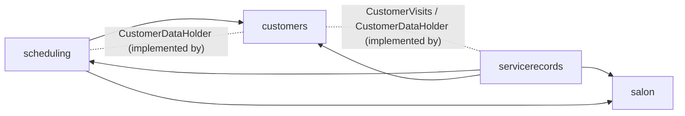
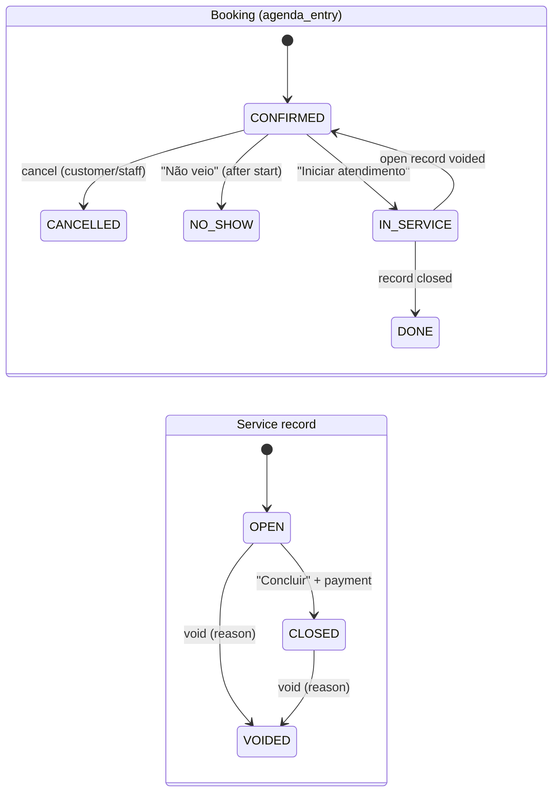

# Design

## Context

See proposal.md for the reasons behind this change. Current state:

**Scheduling**
- `scheduling` owns `agenda_entry` (BOOKING or BLOCK) and `booking_group` (code and manage link).
- Overlap is refused by the exclusion constraint `agenda_entry_no_overlap ... where (status = 'CONFIRMED')`. Error 23P01 is mapped to `slot-taken`.
- A booking copies the customer's name and phone. There is no customer entity.
- BOOKING rows must have `group_id`, `customer_name`, `customer_phone` and `origin` (check constraint in V6).

**Module and access rules**
- Spring Modulith checks that module dependencies are acyclic. Cross-module needs go through small interfaces (`MembershipLookup`, `BreakGlassLookup`, ...).
- Every tenant table has RLS `tenant_id = app_tenant_id()` (forced) and composite FKs `(tenant_id, id)`. Permissions live in `Permissions.kt` and are checked with `@access.can(...)`.
- Personal data uses typed values (`PersonName`, `Phone`, `PersonalText`). They are masked for support, and their `toString()` redacts the value.

**Time and money**
- Money is a `Long` in cents and is sent to the API as decimal strings.
- A `Clock` bean exists, so tests can freeze "now" (needed for the no-show and walk-in rules).

## Goals / Non-Goals

**Goals:**
- One state machine per concept (booking, record), with the transitions enforced by the database where a race is possible.
- No module cycle: `customers` knows nothing about bookings or records.
- History, search and the professional's scope come from SQL. No denormalised counters to keep in sync.

**Non-Goals:**
- No events or outbox between modules yet; calls stay in-process and in one transaction. Asynchronous events arrive with `event-backbone`.
- No soft-delete of records. Voiding is the only way to undo one.
- No pagination tuning for very large salons. Keyset paging is enough for thousands of customers.

## Decisions

### D1. Three modules, dependencies pointing one way

The modules depend on each other like this:
- `customers`
  - Owns the `customer` and `customer_consent_event` tables.
  - Exposes `CustomerDirectory` with `linkOrCreate(phone, name): CustomerId` and `find(id)`.
  - Declares two plug-in interfaces: `CustomerVisits` (visit days, totals and no-shows of a customer) and `CustomerDataHolder` (export and anonymise its part of a customer's data).
- `scheduling` → `customers`
  - Calls `linkOrCreate` on every new booking.
  - Implements `CustomerDataHolder` for bookings and booking groups.
- `servicerecords` → `scheduling`, `customers`, `salon`
  - Owns `service_record` and `service_record_item`.
  - Uses the `BookingLifecycle` interface published by `scheduling`: `start`, `finish`, `reopen`, `occupy` (walk-in), `trimEnd` and `release`.
  - Implements `CustomerVisits` and `CustomerDataHolder`.

**Alternatives considered:**
- *Customers reads the bookings and records tables directly.* Rejected: it makes the module graph lie, because it shows no dependency where a real one exists.
- *Records live inside `scheduling`.* Rejected: `finance` will build on records, and the agenda should not grow into the cash register.
- *Domain events between modules.* Rejected for now. The transitions must be atomic: starting a record and moving the booking to IN_SERVICE either both happen or neither does. Spring Modulith events after commit would need compensation. This is revisited in `event-backbone`.

### D2. Booking and record state machines

- **Every transition is a conditional update.** For example: `update agenda_entry set status = 'IN_SERVICE' where id = :id and status = 'CONFIRMED'`. Zero rows updated means someone else got there first, so the API answers with a validation problem holding the current state. This uses no locks and is race-safe, the same idea as "first commit wins".
- **Walk-in entries are created already IN_SERVICE** with origin WALK_IN. They have no CONFIRMED phase.

**Alternative considered:** a status-history table. Rejected for now. The audit log covers the sensitive transitions (void), and `finance` can add history if it needs it.

### D3. Exclusion constraint covers time that is held

V8 drops `agenda_entry_no_overlap` and recreates it with `where (status in ('CONFIRMED','IN_SERVICE','DONE'))`.
- **Recreating is safe:** no row has the new statuses before V8.
- **DONE is included.** A past service must not be overwritten by a staff booking created for the past, for example when someone fixes yesterday's agenda.
- **NO_SHOW and CANCELLED are excluded** because they free the time.
- **Same pattern as `slot-taken`:** availability queries use the same three statuses, and a test asserts that the SQL constant and the constraint predicate match.

**Alternative considered:** keep CONFIRMED only, and make the record "hold" time some other way. Rejected: there would be two sources of truth for "busy".

### D4. Walk-in and extra items occupy the agenda through `BookingLifecycle.occupy`

An item that does not come from a booking calls `occupy(professional, service, start, end, customer)`. This inserts an `agenda_entry` with kind BOOKING, origin WALK_IN and status IN_SERVICE.

- **Start time:**
  - first item: `now` truncated to the minute;
  - later item with the same professional in the same record: the end of that professional's previous item in the record.
- **End time:** start plus the service duration.
- **Conflict:** an overlap raises 23P01, which becomes `slot-taken` naming the conflicting booking time. The whole "Novo atendimento" request rolls back, so no record is left behind.
- **Schema change in V8:** `group_id` becomes optional when `origin = 'WALK_IN'`, because walk-ins have no code or manage link.
- **Link to the item:** `service_record_item.agenda_entry_id` is unique and nullable, so each entry has at most one item.

**Alternative considered:** walk-ins do not touch the agenda. Rejected by the user's decision: the customer would see times as free while the professional is busy.

### D5. Closing early frees the rest of the time (`trimEnd`)

On close, each entry of the record with `ends_at > now` gets `ends_at = ceil15(now)`, but never earlier than `starts_at + 15 min`. Entries that ran late are not extended, because extending them could collide with the next booking. Late running is a fact for `finance`, not an agenda change.

### D6. Customer identity, linking and backfill

**Tables**
- `customer(id, tenant_id, phone, name, search_key, notes, marketing_consent, consent_changed_at, anonymised_at, created_at)`.
- `phone` is E.164 (`Phones.normalize`, already used by scheduling). It is unique per tenant through a partial unique index `where phone is not null`, so anonymised customers do not hold the phone.
- `search_key` is a generated column: `translate(lower(name), 'áàâã…', 'aaaa…')`. The database keeps it right on every write, and the typed term goes through the catalog's `nameKey` normaliser in Kotlin. We don't use the `unaccent` extension, because it would add a new superuser-installed dependency.

**Linking**
- `linkOrCreate` runs `insert ... on conflict (tenant_id, phone) where phone is not null do nothing`, then reads the row back.
- Concurrent first bookings from the same phone therefore end up linked to the same customer, without savepoints.

**Backfill and constraints**
- V8 backfills customers from existing bookings: one per phone, named after the most recent booking, then sets `agenda_entry.customer_id`.
- `agenda_entry.customer_id` is a composite FK to `customer (tenant_id, id)`. The code always sets it for bookings. The `not null` check for BOOKING comes in a later migration (see Migration Plan).

**Alternative considered:** identify customers by name plus phone. Rejected: families share a phone less often than people mistype their names. The user chose phone.

### D7. Professional scope through a view, enforced on the server

The view `customer_professional (tenant_id, customer_id, professional_id)` is the union of:
- bookings that are not cancelled;
- record items.

The view is created by the migration with `security_invoker = true`, so RLS of the underlying tables applies.

**How each module applies the scope:**
- Customer queries for a PROFESSIONAL add `exists (select 1 from customer_professional ...)`.
- Record queries filter on `exists item with professional_id = :linked`.
- The linked professional comes from the same lookup the agenda uses.
- A customer or record outside the scope answers **not-found** (not 403), so its existence is not revealed.
- Adding an item for another professional answers **403**, because the professional is visible to staff anyway.

**Alternative considered:** a scope column copied on the customer. Rejected: one customer has many professionals over time.

### D8. History computed on read

- **The view `customer_visit_stats`** aggregates, per customer, over CLOSED records:
  - visits (distinct days);
  - `total_cents`;
  - `last_visit`;
  - no-shows from `agenda_entry`.
- **Usual interval:**
  - Kotlin computes the median of the gaps between distinct visit days (`CustomerVisits.visitDays`);
  - with an even count, it takes the lower integer of the mean of the two middle gaps;
  - it is shown only with 3 or more visits;
  - it is a pure function with unit tests.
- **The list sorts by `last_visit desc nulls last`,** with offset paging (page size 30, at most 100). Keyset paging with `nulls last` needs a composite cursor. It is not worth it below a few thousand customers per salon, so it is left for when the list gets slow.

**Alternative considered:** counters updated on close. Rejected: they need correction on void and anonymise, and they drift. Revisit if the list gets slow, which is unlikely below 100k records per salon.

### D9. Records, items and money

**`service_record` table**
- Columns: `id`, `tenant_id`, `customer_id`, `status`, `payment_method`, `opened_at`, `closed_at`, `total_cents`, `void_reason`, `voided_at` and `voided_by`.
- `total_cents` is set on close and recomputed on every item change while OPEN. A check ensures it is ≥ 0.
- A partial unique index `(tenant_id, customer_id) where status = 'OPEN'` guarantees one OPEN record per customer.
- Check constraints tie the status to its fields:
  - CLOSED needs a payment method and `closed_at`;
  - VOIDED needs a reason.

**`service_record_item` table**
- Columns: `id`, `tenant_id`, `record_id`, `service_id`, `professional_id`, `price_cents` (check between 0 and 1,000,000) and `agenda_entry_id`.

**Constraints**
- All FKs are composite, with `tenant_id`.
- Payment method enum: PIX, CASH, DEBIT, CREDIT, shown in pt-BR as Pix, Dinheiro, Débito and Crédito.

### D10. Anonymisation

The OWNER confirms by typing "ANONIMIZAR". Then, in one transaction:

1. **Refuse if** the customer has an OPEN record or a future CONFIRMED booking.
2. **`customers` erases its own data:** the customer's name becomes `Cliente anonimizado`, and phone, notes and `search_key` are set to null. It sets `anonymised_at`. Consent events keep dates and source, but the actor is kept, not erased: that is staff data, not customer data.
3. **Each `CustomerDataHolder` erases its part.**
   - `scheduling`:
     - sets the bookings' `customer_name` to the placeholder and `customer_phone` to null;
     - sets `booking_group.phone` to null and replaces `token_hash` and `code_hash` with random values, so old links and codes stop working.
   - `servicerecords` has nothing personal, because records reference the customer by id. It keeps amounts, so it does nothing.
4. **Audit:** CUSTOMER_ANONYMISED with the customer id.

Columns that were `not null` only to hold personal data (`agenda_entry.customer_phone`, `booking_group.phone`) become nullable in V8. The booking flows keep requiring them in code.

**Alternative considered:** hard delete with cascade. Rejected: it erases the salon's revenue history. LGPD allows keeping data needed by the controller's legal obligations, and anonymised data is no longer personal data.

### D11. Export

`GET /customers/{id}/export` returns a JSON attachment built from:
- the customer;
- consent events;
- `CustomerDataHolder.export` from every module.

It is OWNER-only and audited as CUSTOMER_DATA_EXPORTED. The file name has no personal data (`cliente-{id}.json`). The response sets `Cache-Control: no-store`.

### D12. Permissions

| Permission | OWNER | MANAGER | PROFESSIONAL | SUPPORT |
|---|---|---|---|---|
| VIEW_CUSTOMERS | ✓ | ✓ | ✓ (scoped) | ✓ (masked) |
| MANAGE_CUSTOMERS (name, phone, notes) | ✓ | ✓ | ✓ (scoped) | |
| MANAGE_MARKETING_CONSENT | ✓ | ✓ | | |
| CUSTOMER_DATA_RIGHTS (export, anonymise) | ✓ | | | |
| VIEW_SERVICE_RECORDS | ✓ | ✓ | ✓ (scoped) | ✓ (masked) |
| MANAGE_SERVICE_RECORDS (start, items, close, no-show) | ✓ | ✓ | ✓ (own items) | |
| VOID_SERVICE_RECORDS | ✓ | ✓ | | |

The no-show action needs MANAGE_AGENDA, which is the same scope rule as cancel.

### D13. Tenant isolation for every new table and endpoint

- **Tables:**
  - `customer`, `customer_consent_event`, `service_record` and `service_record_item` get RLS enabled and forced, plus the policy `tenant_id = app_tenant_id()`.
  - FKs are `(tenant_id, x)`, so a row can never point to another salon's customer, service or professional.
- **Views:** both views are `security_invoker`, so they cannot widen reads.
- **Endpoints:**
  - All endpoints are under `/api/v1/tenants/{t}/...`, with the membership check that already exists.
  - Every new test class has a cross-tenant scenario that expects not-found.
- **Public endpoints:** none are added. Public booking only gains the call to `linkOrCreate` inside the tenant context it already resolves.

### D14. Front-end flow

**Agenda booking sheet:**
- CONFIRMED offers "Iniciar atendimento", "Não veio" (after start), "Remarcar" and "Cancelar".
- IN_SERVICE offers "Abrir comanda".

**Comanda sheet** (also used for walk-in):
- items with an editable price (numeric keypad, R$ mask);
- "+ Serviço";
- the total;
- "Concluir", which opens the four payment buttons. Tapping one closes the record.

That makes 3 taps from the booking.

**"Novo atendimento" on the agenda:**
- the phone input comes first and looks up the customer as you type, after 8 or more digits;
- then the service and professional, with the professional preselected for a PROFESSIONAL user.

**"Clientes" menu:**
- search, then a list with last visit;
- a detail page with the stats on top (visits, total, last visit, "costuma voltar a cada N dias"), notes, consent toggle and history;
- for OWNERs, a "Privacidade" section with export and anonymise.

## Risks / Trade-offs

- **[Changing the exclusion constraint on a live table]** Dropping and recreating it takes a lock on `agenda_entry`. → The table is small, V8 runs before the app starts, and the new predicate is a superset with no rows to violate.
- **[Backfill picks the "wrong" name]** One phone with several names in old bookings → the most recent wins and staff can rename. The bookings keep the name typed at booking time.
- **[Views hide the cost of history]** Aggregation on every read → the indexes `(tenant_id, customer_id, status)` on records and `(tenant_id, customer_id)` on agenda_entry, and the list is paged. A follow-up materialises the views only if p95 gets worse.
- **[Professional scope through a union view]** It is easy to forget the filter in a new query → the scope helpers are the only way repository methods are built for PROFESSIONALs, and the API tests cover each endpoint with a PROFESSIONAL of another professional.
- **[Free-text notes may hold health data]** For example allergies, which are sensitive data under LGPD → the UI hint "visível para a equipe", masking for support, no logs. A "sensitive" tag with consent is left to a later change, if salons ask for it.
- **[Walk-in at "now" with clock drift]** The server clock decides → it uses the `Clock` bean and the salon time zone, never the browser time.
- **[Synchronous cross-module calls]** They couple transactions → this is intentional for atomicity (D1). `event-backbone` revisits it.

## Migration Plan

1. **V8__customers_and_service_records.sql** (one migration, one transaction):
   1. Create `customer` and `customer_consent_event` with RLS.
   2. Backfill customers from `agenda_entry` per tenant. Run as `estilix_owner` with BYPASSRLS, like every migration.
   3. Add `agenda_entry.customer_id` (nullable) and fill it.
   4. Widen the status and origin checks.
   5. Relax `group_id` for WALK_IN and the phone columns.
   6. Recreate the exclusion constraint.
   7. Create `service_record` and `service_record_item` with RLS, plus the two views and their grants for `estilix_app`.
   8. Update the launch plan features ("Atendimento em 3 toques" becomes available).
2. **Seed:** extend `R__demo_data.sql` with customers, past closed records over several months (so the usual interval shows), one NO_SHOW, one OPEN record today and marketing consent on some customers.
3. **Rollback:** the change is forward-only, like all migrations. In an emergency, an app rollback with V8 applied still works, because the old code only writes CONFIRMED and CANCELLED, which the new constraints accept. The `customer_id` requirement on BOOKING would break old-code inserts, so the required-FK step is left to a later migration (V9) after the release is verified. V8 only makes the column nullable plus filled.

## Open Questions

- Should "Não veio" send anything to the customer? It is deferred to `notifications`, and the specs don't depend on it.
- Should records allow splitting the payment across two methods? Not now. The user chose one method; revisit with `finance`.
